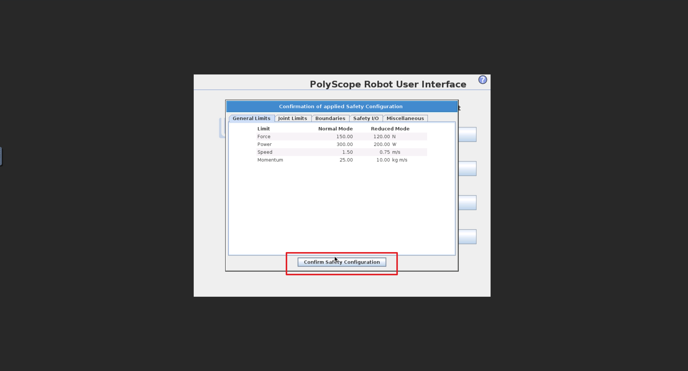

# Lab 4 — Control URSim with your arm

## Purpose

Use OpenCV and MediaPipe to find your arm in a camera image, compute your elbow
angle, and move the simulated UR5 with it. The robot follows one joint from a
calibrated neutral pose; this is two-joint gesture control, not human pose
reconstruction or motion planning.

## Safety and privacy

**Students: simulation only. Do not connect this program to a physical robot.**
Joint bounds and rate limits do not make motion physically safe, and the
keyboard stop is not an emergency stop. The only hardware use is the instructor
demo described under Setup, which selects a real controller with `--host`.

On the **native path**, Python reads your camera directly and images stay on
your computer. The optional **Codespaces browser fallback uploads camera frames
to your private Codespace** for Python/MediaPipe processing and returns annotated
previews. Use it only if you consent to that transfer; keep its forwarded ports
private. Neither path records images automatically. Saving evidence writes one
annotated image; Task 3 also saves a CSV. Check the background before saving or
submitting. Quitting/Stop camera releases the camera.

## What you run

Start the script for the task you are working on. Each opens one camera window;
only Task 3 connects a robot.

| File | Purpose | Edit? |
|---|---|---|
| `task1_landmarks.py` | Task 1: landmarks in the preview | run |
| `task2_elbow_angle.py` | Task 2: elbow angle in the preview | run |
| `task3_control.py` | Task 3: calibrate and drive URSim (or a UR controller with `--host`) | run |
| `web_lab.py` | optional browser camera fallback for Tasks 1–3 | run |
| `student.py` | `elbow_angle()` — your Task 2 implementation | **yes** |
| `student_config.py` | gains, bounds, smoothing, shoulder switch | **yes** |
| `report.md` | report template | **yes** |
| `submit.py` | packages the submission | no |
| `lab4lib/` | supplied helpers: `camera`, `vision`, `controller`, `session`, `overlay`, `evidence` | no |
| `compose.yaml` | URSim container for Task 3 | no |

## Setup

### Primary path — native camera

Use **VS Code on your computer**, with the repository open as a normal folder,
and a native terminal (on Windows, PowerShell rather than WSL). These native
camera scripts do not run in a headless Dev Container/Codespace; use the
[browser fallback](#optional-fallback--codespaces-browser-camera) there instead.
Install [uv](https://docs.astral.sh/uv/getting-started/installation/).
Use an up-to-date uv; CI pins **0.13.9**. Run `uv --version`; if an older uv
rejects the lock format/settings, update with `uv self update` for a standalone
install, or your package manager's upgrade command.

From the repository root:

```sh
cd lab4
uv python install 3.12
uv sync --locked
uv run --no-sync python check_setup.py
uv run python task1_landmarks.py
```

Use the **same native terminal and Lab 4 environment for every task**. Do not use
bare `python`, a notebook kernel, or VS Code's Run button with the Labs 1–3/root
interpreter. `uv run` from `lab4` selects `lab4/.venv`; the setup check prints the
exact interpreter path, Python version, architecture, package version, and native
import results. Stop if `uv sync --locked` fails—Tasks 1/2 opening does not prove
that the RTDE dependency installed.

If VS Code asks for an interpreter, select `lab4/.venv/bin/python` on macOS/Linux
or `lab4\.venv\Scripts\python.exe` on Windows. Selecting it in VS Code does not
change an already-open terminal's interpreter. No environment activation or
separate `pip install` is needed when using the commands above.

| Native platform | Lab environment |
|---|---|
| Windows x64 | CPython 3.12, RTDE wheel from PyPI; use native PowerShell, not WSL |
| Apple Silicon Mac | macOS 15+, ARM64 CPython 3.12, bundled RTDE wheel |
| Intel Mac | macOS 15+, x86_64 CPython 3.12, bundled RTDE wheel; the lock selects older compatible MediaPipe/NumPy/OpenCV |
| Linux x86_64 desktop | CPython 3.12, RTDE wheel from PyPI |

Windows ARM64 and older macOS are **not covered by this locked setup**. Do not
change Python versions or install random wheels to bypass a failed sync. On an
Apple Silicon Mac, use a native ARM64 terminal/Python rather than mixing Rosetta
and ARM64 environments.

The package installed is named **`ur-rtde`** (also normalized as `ur_rtde`), but
its Python modules are **`rtde_control` and `rtde_receive`**. `import ur_rtde`
is not an installation check and fails even when the correct package is installed.

#### macOS wheels

`lab4/wheels/` contains single-architecture CPython 3.12 RTDE wheels requiring
macOS 15+. `uv sync --locked` selects them automatically; Homebrew and a local
C++ build are not required. The source markers select a local wheel explicitly:
an older Mac does **not** automatically fall back to a source build.

The wheel-build workflow bundles Boost and checks native library links. Separate
install CI tests the **full locked Lab 4 environment**, not only the RTDE wheel.
Intel Macs need the older dependency set because the newer MediaPipe release
in the original lock did not publish an Intel Mac distribution.

Maintainers, after a successful run: download the artifacts, copy the wheels into
`lab4/wheels/`, update the `[tool.uv.sources]` entry in `lab4/pyproject.toml` if
the file names changed, then re-run `uv lock` in `lab4` and commit both.

Students on a matching Mac do nothing extra: `uv sync --locked` picks the wheel,
and `uv run python task3_control.py` uses it.

`--camera 0` is the default device; add `--camera 1` (or another index) if the
wrong camera opens. Allow camera access for your terminal in the operating
system's privacy settings, and close other apps using the camera. The preview is
**not mirrored**: MediaPipe's *left* is your anatomical left.

The first run downloads the MediaPipe Pose Landmarker Lite model (about 6 MB)
into `lab4lib/models/`; later runs use the cache. Delete that file if the app
reports it is corrupt. The model is not submitted.

### Optional fallback — Codespaces browser camera

Use this when native camera/RTDE installation or local Docker is a blocker.
Your laptop needs only a camera and a supported desktop browser; Python,
MediaPipe, your `student.py`, and URSim run in the Codespace. Native setup above
remains the primary path. The browser fallback accepts only the supplied
simulator hosts, not physical robot addresses.

1. Create a Codespace from this repository's current `main`, or rebuild an
   existing Codespace to pick up the updated Dev Container image/configuration.
   Wait for setup to finish. A **4-core machine is recommended** for URSim and
   MediaPipe together; stop the Codespace when finished to limit usage charges.
2. In **Ports**, open **URSim noVNC** (`ursim_cb3:6080`) in your browser and append
   `/vnc.html` to its forwarded URL. Keep the port **Private**. Choose **Program
   Robot**, load/confirm the safety configuration if prompted, initialize power,
   release brakes, and open the Move tab as described
   [below](#ursim-for-task-3). **Do not run `lab4/docker compose up` here:** the
   Dev Container already starts URSim.
3. In the Codespace terminal:

   ```sh
   cd /workspace/lab4
   uv sync --locked --extra browser
   uv run --no-sync python check_setup.py --robot --host ursim_cb3
   uv run --no-sync python web_lab.py --host ursim_cb3
   ```

   Fix any failed setup check before Task 3. Use `ursim_cb3` for the internal
   robot connection, **not** its forwarded HTTPS/VNC URL. The root `uv sync`
   does not install the separate Lab 4 environment. Close other Task 3/Lab 2
   control processes first; the browser ownership lock applies to this server,
   not to competing programs.
4. Open **Lab 4 browser camera**, port **8000**, using **Open in Browser** in
   Ports. Confirm visibility is **Private**; do not make either port public.
   Open the forwarded **HTTPS URL as its own browser tab**, not VS Code's
   embedded preview. Click **Start camera**, allow camera access for that site
   and your browser in the OS settings, then select Task 1, 2, or 3.
5. Follow the same exercises below. Task 2 still requires your implementation
   of `student.elbow_angle()`. **After editing Python/config files, Stop camera,
   stop the server with Ctrl+C, and rerun the last command**, then refresh and
   reconnect. The running Python process does not reload edits.
6. For Task 3: **HOME → wait for At HOME → Calibrate → Enable**. Keep your left
   shoulder, elbow, and wrist visible. Use **Stop**/**Space** to disarm; use
   **Stop camera** before leaving. Keep the camera page visible; browser
   throttling/background suspension and slow networks can pause tracking.
   View URSim in a second visible window if needed. Only one browser tab can
   own the controller; close/stop the first before opening another.
7. **Save evidence** writes the same `outputs/taskN_preview.jpg` and Task 3
   CSV as the native scripts; download links also appear in the page. Save
   each task separately. Edit `report.md` in the Codespace, then package with
   `uv run --no-sync python submit.py` and download `lab4/submission.zip` from
   VS Code's Explorer for Canvas. The images/CSV are already on the server;
   downloaded copies need not be uploaded back.

Use `--no-sync` after the explicit browser sync (or include `--extra browser`
on subsequent `uv run` commands), so uv does not remove the optional web packages.
No local Python, Docker, VNC application, RTDE port forwarding, or desktop
OpenCV window is needed for this route. Ports default to private in Codespaces;
the Dev Container's port labels are not authentication—verify visibility.

The browser sends at most 640 × 480 JPEGs, around 10 fps, with one frame in
flight. All pose calculation stays in the Codespace; the robot worker remains
125 Hz there. A server-issued frame credit bounds capture/transport freshness;
delayed frames are dropped rather than queued as new targets. Missing tracking
pauses following and fresh tracking resumes while armed. **Stop, camera stop,
or browser disconnect disarms**; reconnecting never enables automatically and
requires a new HOME/calibration/enable sequence. Network loss first triggers the
worker's 0.75-second stale-target pause; connection cleanup then disarms.

For diagnosis, send the terminal setup/server output and live controller status,
not a camera image. If an older Codespace has no 8000 port, rebuild/restart the
container or forward `8000` manually; no camera prompt usually means an embedded
preview, non-HTTPS URL, denied site/OS permission, or another app using the camera.

### URSim for Task 3

If you don't have Docker installed, follow the instructions at:

- Mac: <https://docs.docker.com/desktop/setup/install/mac-install/>
- Windows: <https://docs.docker.com/desktop/setup/install/windows-install/>

Docker runs **only URSim**. From `lab4`:

```sh
docker compose up -d
```

Open <http://localhost:6080/vnc.html>. Choose **Program Robot** to load the
installation; if an initial **Power off** popup blocks the menu, choose
**Not now** first (this only postpones power initialization). When the
**Confirmation of applied Safety Configuration** dialog appears, review it and
click **Confirm Safety Configuration**. Then initialize power, release the brakes,
and open PolyScope's Move tab. Loading/confirming the installation and powering
on are separate prerequisites: RUNNING/NORMAL dashboard states alone do **not**
prove that the installation was loaded and its safety configuration confirmed.



Wait for the robot to be ready; `docker compose up -d` returning and VNC opening
do **not** prove that the robot control services are ready.

Before opening Task 3, run this **read-only, camera-free** check from `lab4`:

```sh
docker compose ps
uv run --no-sync python check_setup.py --robot --host 127.0.0.1
```

It checks the environment, the dashboard (`29999`), script upload (`30003`), RTDE
(`30004`), and queries robot/safety/program state. It never powers on, uploads a
program, or moves the arm. Fix any failed check first. `RUNNING` robot mode and
`NORMAL` safety mode are expected for the lab; a stopped program before **I**
is normal. The check cannot prove that a later control script will execute.

The compose file also publishes `30001`/`30002`; keep its published ports
unchanged. After changing Compose ports, recreate the container:

```sh
docker compose up -d --force-recreate
uv run python task3_control.py --host 127.0.0.1
```

Task 3 and the setup checker default to `URSIM_HOST` if set; otherwise native
Windows uses `127.0.0.1`, and macOS/Linux use `localhost`. The explicit IPv4 host
above bypasses stale environment variables and matches Compose's IPv4 bind.
Use `127.0.0.1` for this local Docker setup, **not** `ursim_cb3` (a Docker-only
service name), a browser URL, or a Codespaces forwarded address. The script prints
its target on startup. Run only one control script against the simulator; close
old Task 3/Lab 2 processes. Ports stay bound to loopback—do not expose them to
the network.

The image is `linux/amd64`; Apple Silicon depends on Docker Desktop emulation.
Linux simulator CI does not validate Docker Desktop's emulation, VPN/firewall
behavior, camera permissions, or a student's VNC session.

When finished:

```sh
docker compose down
```

If Docker reports a port is already allocated, stop the Labs 2–3 devcontainer
stack first; both publish the same simulator ports.

#### Real controller demo (instructor only)

`uv run python task3_control.py --host <robot IP>` uploads the same
URScript control program and streams `servoJ` setpoints to a physical UR
controller instead of URSim. Everything else — keys, bounds, watchdog, evidence —
is unchanged. This path has only been exercised against the simulator.

Before enabling motion:

- Put the robot in **remote control** mode on the pendant, with RTDE reachable
  from your laptop on the same network.
- Check `HOME_Q` and `JOINT_MIN`/`JOINT_MAX` in `student_config.py` against the
  real cell. They describe the empty simulated scene, so **I** may drive into a
  table, fixture, or hard joint limit; edit them before connecting.
- Clear the workspace, keep PolyScope visible, and keep the emergency stop
  within reach. The app does no collision checking, payload or TCP
  configuration, or safety-plane handling. Motion is slow (0.25 rad/s) but
  starts on **I**.
- Tracking loss pauses following, but **motion resumes automatically** when a
  fresh pose returns. It is not a disarm or safety-rated stop. **Space**/**S**,
  closing the window, and camera failures disarm control. HOME is an explicit
  move independent of tracking; use **Space**/**S** to cancel it.

A non-local target prints a startup warning; that is expected for real hardware.
The app stays at 125 Hz (`CONTROL_FREQUENCY`), which both CB3 and e-Series
controllers accept.

## Task 1 — Get the arm landmarks with MediaPipe

Run `uv run python task1_landmarks.py`.

1. No robot is connected for this task.
2. MediaPipe Pose returns 33 body landmarks in normalized `[0, 1]` image
   coordinates. The supplied `lab4lib/vision.py` selects the anatomical left
   shoulder, elbow, and wrist — indices 11, 13, and 15 in
   `lab4lib.vision.LEFT_ARM` — and scales them to pixels using the frame size.
3. Check that the three labelled points and connecting lines follow your left
   arm. Record those landmark indices; Task 2 uses the same three points.
4. Exercise the failure cases and record the overlay message for each: no person
   in view, a low-visibility landmark (turn away or leave the frame), an arm
   partly outside the image, and two landmarks collapsing onto each other. The
   app must report the problem instead of showing invented coordinates.
5. Press **1** with a clear tracked pose.

Generated file: `outputs/task1_preview.jpg`.

## Task 2 — Calculate the elbow joint angle

Run `uv run python task2_elbow_angle.py` after editing `student.py`.

1. `student.elbow_angle(shoulder, elbow, wrist)` is yours to implement; the
   supplied version raises `NotImplementedError`. Until it works, the overlay
   shows the landmarks plus `Landmarks tracked. Implement elbow_angle()…`, and
   Task 3 cannot move the robot.
2. Return the interior angle at the elbow in radians, within `[0, π]`; the
   overlay converts it to degrees for display. Each argument is one pixel point
   — an `(x, y)` tuple, list, or numpy row. `arm_points()` validates the input
   and returns the three pixel coordinates; use those, not the normalized
   landmarks, because normalized coordinates distort angles unless the image is
   square.
3. Measure at the **elbow**, between the two segments pointing away from it:

   ```
   a = shoulder - elbow        b = wrist - elbow
   ```

   A straight arm is π (180°); a right angle is π/2 (90°). The result does not
   depend on how close you stand to the camera — only on the arm's shape.
4. Either formula works:
   - cosine rule: `angle = arccos((a·b) / (|a|·|b|))`, clipping the cosine to
     `[-1, 1]` first so rounding cannot turn a straight arm into NaN;
   - `atan2` form: `angle = atan2(abs(a_x*b_y - a_y*b_x), a·b)`, which needs no
     clipping and stays accurate for very small or very large vectors. The
     **absolute** cross product is what keeps the result in `[0, π]`; without
     it the sign flips whenever you bend the other way.
5. Check the math before pointing the camera at yourself:

   ```sh
   uv run python -c "import math; from student import elbow_angle as e; print(round(math.degrees(e((0,0),(0,1),(1,1)))))"
   ```

   This should print `90.0` (right angle). Try `((0,0),(1,0),(2,0))` for a
   straight arm (`180.0`) and `((0,0),(1,0),(2,1))` for a 45° bend (`135.0`).
6. Verify against the poses below, then press **2** with a clearly tracked pose.

Common mistakes: using the normalized landmark values instead of pixels; calling
`arccos` without clipping and getting `nan`; using a signed cross product and
getting negative angles; measuring at the shoulder, or using
`wrist - shoulder`; returning degrees when the caller expects radians.

Generated file: `outputs/task2_preview.jpg`.

## Task 3 — Move the UR5 using that angle

Run `uv run python task3_control.py` with URSim started as
described above.

1. `student.joint_targets()` maps the change from a calibrated neutral pose onto
   bounded UR5 joints. Joint 2 is the elbow: home elbow angle plus `ELBOW_GAIN`
   times the change in your elbow angle, clipped to `JOINT_MIN`/`JOINT_MAX`. All
   other joints stay at `HOME_Q`.
2. Hold a comfortable pose and press **C** while stopped; that pose maps to
   `HOME_Q`. Move your elbow without enabling URSim and confirm the six target
   values respond. Change only `ELBOW_GAIN` (smaller magnitude, then the
   opposite sign), restarting and recalibrating each time. Explain the direction,
   sensitivity, and clipping; use a positive gain for your first live test.
3. Press **I** once to move to `HOME_Q` at limited speed. HOME does not depend on
   camera tracking; **Space** or **S** cancels it.
   **Wait for the controller status to say "At HOME" before pressing C, then E.**
   Calibrate with your left shoulder, elbow, and wrist visible. Once enabled,
   move slowly while comparing target and actual joint positions with PolyScope.
   Pressing **C** or **E** too early stops initialization when the action is refused.
4. Hide your wrist: following must pause as soon as a frame reports missing
   tracking. Show your arm again: following resumes toward the current angle
   without another **E** or recalibration. `enabled=True` means tracking control
   is armed, even while paused. Then press **Space** or **S**: returning tracking
   must not restart motion until you explicitly press **E** again. Close the
   preview to check cleanup. A camera read failure also disarms control; if it
   is safe to disconnect your camera, test it, otherwise state that it was not
   exercised. Restart, initialize, and recalibrate after quitting or camera failure.
5. Compare `SMOOTHING_TIME_CONSTANT = 0` with the supplied `0.15` seconds, gains
   unchanged. Explain the jitter/lag tradeoff; filtering does not replace the
   motion-rate limit.
6. Run a short trial with enabled motion and a tracking-loss stop, then press
   **3** before quitting.

Generated files: `outputs/task3_preview.jpg` and `outputs/task3_control.csv`.
The CSV contains `time_s`, `tracking`, `enabled`, `human_elbow_rad`,
`human_shoulder_rad`, `target_q1`–`target_q6`, and `actual_q1`–`actual_q6`. Time
is elapsed monotonic time since the app started; angles are radians. Blank
entries mean unavailable data, not zero. The file holds the latest 6000
observations since start, **not** every 125 Hz servo command. Restarting clears
the log, and saving again overwrites the same files.

### Optional extension — also follow your upper arm

After Task 3 works, set `CONTROL_SHOULDER = True` and choose `SHOULDER_GAIN`.
Joint 1 then follows the supplied `student.shoulder_angle()`. Restart,
initialize, and recalibrate, then test slow elbow and shoulder motion with the
other four joints fixed.

## Controls

Keys work only while the OpenCV window has focus. Switching windows does not stop
camera capture or motion, so press **Space** or **S** before switching away.

| Script | Keys |
|---|---|
| `task1_landmarks.py` | **1** save Task 1 evidence · **Q**/**Esc** quit |
| `task2_elbow_angle.py` | **2** save Task 2 evidence · **Q**/**Esc** quit |
| `task3_control.py` | **I** move to HOME · **C** calibrate · **E** enable · **Space**/**S** stop · **3** save Task 3 evidence · **Q**/**Esc** quit |

Closing the preview, a camera read failure, Ctrl+C, and exceptions disable
control and release the camera, tracker, and controller. Missing or stale pose
data pauses following without disarming it; a fresh pose resumes automatically.
**Space**/**S** disarms control and requires **E** to resume.

## Supplied control behavior

The main thread captures, processes, and displays frames with OpenCV. Task 3's
overlay shows tracking, human angle, targets, actual/controller status,
processing time, key help, and action errors. Displayed processing time is not
complete camera-to-robot latency: capture buffering, display, scheduling,
communication, and robot response also contribute. Frames are capped at
640 x 480; camera buffer size is requested but backends may ignore it, so check
latency rather than assuming the read timestamp is the exposure time.

HOME is ready only after the joints are at rest at `HOME_Q` and a synchronous
`stopJ` has released the asynchronous HOME thread's motion ownership. Measured
arrival alone is insufficient: overlapping HOME and servo control aborts URScript.

A separate worker owns the RTDE connection, uses the latest target, smooths
changes, and limits commanded joint speed. The CB3 UR5 control loop targets
125 Hz independently of the camera loop, and a normal desktop OS is **not**
hard-real-time. A frame without usable tracking discards the previous target
and requests a controlled stop; it does not keep chasing that old angle.
Fresh tracking resumes from the measured joints with the same smoothing and
speed limits. If frames stop arriving entirely, the worker watchdog pauses
following after `TARGET_MAX_AGE` (0.75 s). Invalid targets or driver errors
still disarm control. Initial enabling and re-enabling after **Space**/**S**
require fresh tracking and an explicit **E**.

The fixed bounds and starting pose suit the supplied empty URSim scene. This lab
does not perform Lab 3 collision checking.

## Submission

Fill in `report.md`, save evidence for all three tasks, then run from `lab4`:

```sh
uv run python submit.py
```

This works in PowerShell as well as macOS/Linux shells. It packages exactly
`student.py`, `student_config.py`, `report.md`, the three images, and
`outputs/task3_control.csv` into `submission.zip`, keeping the `outputs/` paths.
Missing files are listed before an existing archive is touched. Upload the ZIP
to the Lab 4 Canvas assignment. The script does not verify report quality or
that the CSV contains a successful trial, and the model cache is not included.

## Troubleshooting

- **No camera / wrong camera:** check OS camera permissions for your terminal,
  close other camera apps, and try another `--camera` index.
- **No native preview window:** use a desktop terminal and the Lab 4 environment
  (GUI OpenCV), not WSL/SSH/headless OpenCV. In Codespaces or a headless Dev
  Container, use the [browser fallback](#optional-fallback--codespaces-browser-camera).
- **Keys do nothing:** focus the OpenCV window. Focus changes do not stop the
  camera or robot; use PolyScope if you cannot reach the keyboard stop.
- **`NotImplementedError` in Task 2:** implement `student.elbow_angle()`. Task 3
  stays blocked until it works.
- **First capture the setup evidence:** run
  `uv run --no-sync python check_setup.py`; for robot issues add
  `--robot --host 127.0.0.1`. Send its complete output, the original sync/error
  output, `docker compose ps`, and the Task 3 controller status—not only the
  last-action line. No camera image is needed for these diagnostics.
- **Windows `ur_rtde not found` / Mac `No module named rtde_control`:**
  distinguish the missing *module* from a failed install command. From `lab4`,
  run `uv sync --locked` and check its exit status, then the setup check above.
  Use `uv run python task3_control.py`, not bare `python`. Confirm the printed
  executable is in `lab4/.venv`, Python is 3.12, and the architecture matches
  the platform table. `import ur_rtde` is the wrong import name.
- **`DLL load failed`, `dlopen`, incompatible architecture, or library not found:**
  the extension may be installed but a native dependency cannot load. Keep the
  original loader message; reinstalling into another interpreter will not explain
  it. On Windows, a message naming `VCRUNTIME140`/`MSVCP140` indicates a missing
  [Microsoft Visual C++ x64 runtime](https://learn.microsoft.com/en-us/cpp/windows/latest-supported-vc-redist);
  do not download individual DLLs. On Mac, confirm macOS 15+, architecture, and
  that sync used the bundled wheel rather than a separately installed package.
- **Old/stale environment:** for a valid environment with suspect packages, use
  `uv sync --locked --reinstall`. If `.venv` was copied from another computer,
  uses another architecture, or is invalid, rename `lab4/.venv` and run
  `uv sync --locked` to create a new one. Do not delete `student.py` or your report.
- **Unsupported Mac / source-build failure:** the supplied wheels require
  macOS 15 and CPython 3.12. The locked source selection does not fall back to
  compilation. Use a supported native environment or the browser fallback;
  a source build is not the student install path.
- **Linux `libEGL.so.1` / `libGLESv2.so.2` missing:** MediaPipe loads native
  image code lazily, so `import mediapipe` alone can succeed before this failure.
  On Ubuntu/Debian, install the system runtimes with `sudo apt-get update` then
  `sudo apt-get install libegl1 libgles2`; these are not Python packages or compilers.
- **Model download/import failure:** read the terminal, confirm
  `uv sync --locked` finished in `lab4`, and check internet access.
- **Connection timeout:** VNC (`6080`) is not RTDE. The setup check must reach
  **all three** control ports on the same host; a failed port identifies the
  network/container layer before Python control is attempted. Check Docker Desktop
  is running, use this lab's Compose file, recreate after port changes, stop the
  Labs 2–3 stack if ports clash, and check VPN/firewall/security software without
  disabling security or exposing robot ports publicly.
  A native “failed to start control script … 5 seconds” error is a different
  phase from the lab's 60-second HOME-arrival timeout: check robot readiness,
  dialogs, port `30003`, and competing clients. The 60-second deadline does not
  bound time spent inside native connection constructors.
  **“Failed to start RTDE data synchronization”** can also occur with an
  unconfirmed safety configuration even when ports connect and the dashboard
  says RUNNING/NORMAL. The read-only check reports the robot's initial RTDE
  warning. In VNC, load/reload the intended installation and complete
  **Confirm Safety Configuration** if prompted, then restart Task 3.
- **“HOME requested” but no motion:** this is the last key request, not a
  success indication. Read the live controller message and `initialized`/`busy`.
  Wait for **“At HOME”** before C/E; pressing C/E while busy refuses the action
  and stops initialization. Dismiss PolyScope dialogs, power on, release brakes,
  and verify the VNC window is the simulator at the printed target. If already
  at `HOME_Q`, no visible movement is expected. Tracking loss does not cancel
  HOME in the current version.
- **Tracking keeps pausing:** a missing/stale pose pauses following; it resumes
  automatically on a fresh pose while enabled. Improve lighting and landmark
  visibility, and check host load. Space/S disarms; E is then required.
- **App unresponsive:** do not assume the robot stopped. Check PolyScope, stop
  there if needed, then reinitialize and re-enable after restarting.

## Maintainer CI checks

- `.github/workflows/lab4-install.yml`: fresh, wheel-only `uv sync --locked`
  on Windows x64, Linux x64, and both Mac architectures; real native imports,
  MediaPipe Tasks API, Task 3 CLI startup, and deterministic tests.
- `.github/workflows/lab4-ursim.yml`: disposable Ubuntu/Compose URSim; powers on
  the **simulator only**, starts away from HOME, checks measured HOME/servo motion,
  tracking pause/resume, watchdog, and explicit stop. It also builds the Dev
  Container image/checks its internal simulator connection, then exercises the
  actual browser page with a synthetic camera, MediaPipe, evidence downloads,
  session ownership/disconnection, and measured URSim motion. Browser-only
  protocol/security tests run with the optional extra. Logs/screenshots are
  uploaded for diagnosis.

The browser smoke test first verifies the unchanged student exercise is blocked.
For motion it substitutes configurable constant **test-only student outputs**,
not an elbow-angle solution; real MediaPipe must still detect the fixture pose.
The public test image comes from MediaPipe's sample assets, never a user camera.

Both run for Lab 4 pushes/PRs and support manual dispatch. Hosted Windows runners
already include Visual C++ runtimes, so a pass does not prove bare-Windows DLL
availability. CI does not test a laptop camera, Docker Desktop emulation,
hosted Codespaces authentication/forwarding, browser permission prompts on each
OS, or school network policy. Use the native route if uploading frames is not
acceptable.

## References

- [MediaPipe Pose Landmarker](https://developers.google.com/edge/mediapipe/solutions/vision/pose_landmarker)
- [OpenCV Python tutorials](https://docs.opencv.org/4.x/d6/d00/tutorial_py_root.html)
- [ur_rtde control API](https://sdurobotics.gitlab.io/ur_rtde/pages/reference/api.html)
- [uv project environment selection](https://docs.astral.sh/uv/concepts/projects/run/)
- [MediaPipe release files and dependencies](https://pypi.org/project/mediapipe/#files)
- [UR controller interfaces and ports](https://www.universal-robots.com/articles/ur/interface-communication/overview-of-client-interfaces/)
- [Codespaces port forwarding and private visibility](https://docs.github.com/en/codespaces/developing-in-a-codespace/forwarding-ports-in-your-codespace)
- [Browser camera access and secure contexts](https://developer.mozilla.org/en-US/docs/Web/API/MediaDevices/getUserMedia)
